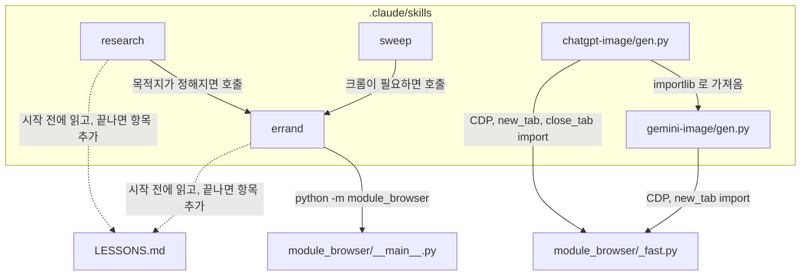
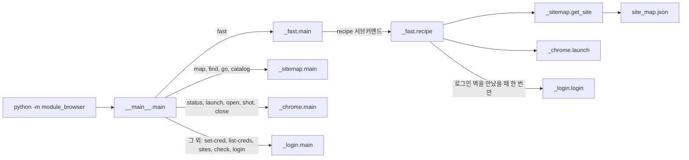

# small_AGENT

One-line summary: A small set of Claude Code skills on top of a dependency-free Chrome DevTools Protocol driver (`module_browser`), plus a trial-and-error log (`LESSONS.md`) that the agent reads before it works and appends to after it fails.

## 한 줄 소개

Claude Code 위에서 실제 크롬을 직접 조종해 "가서 보고 오는" 일을 시키는 작은 비서 묶음이며, 에이전트가 밟은 함정을 기록장에 남겨 다음 세션이 같은 실수를 반복하지 않게 하는 개발 환경을 함께 설계했다.

## 무엇을 왜 만들었나

검색 결과 요약만으로는 마감 시각, 정원, 제약 조항 같은 세부가 조용히 빠진다. 값은 채워져 돌아오기 때문에 빈 칸이 없어 보이고, 틀렸다는 사실을 발견하기 어렵다. 이 저장소는 그 문제를 두 방향으로 다룬다. 하나는 요약이 아니라 실제 크롬으로 해당 페이지를 열어 본문을 읽는 경로(`module_browser`와 스킬 다섯 개)이고, 다른 하나는 에이전트가 새로 밟은 함정을 같은 작업 턴에 `LESSONS.md` 에 적게 하는 규칙(`CLAUDE.md` 원칙 5)이다.

Selenium 경로(`_chrome.attach`)는 부를 때마다 chromedriver 프로세스를 새로 띄워 한 번 붙는 데 1,567ms 가 걸렸다(`_fast.py` 상단 주석의 측정값). 그래서 CDP(Chrome DevTools Protocol) 웹소켓에 직접 말하는 `module_browser/_fast.py` 를 만들었고, 같은 일이 21ms 로 줄었다. 이 파일은 표준 라이브러리만 사용하며, WebSocket 프레이밍도 직접 구현한다. Selenium 은 로그인 자동 입력과 옛 명령(`open`, `shot`)에서만 함수 안에서 불러온다(`_chrome.py` 의 lazy import).

## 핵심 구조

스킬 다섯 개는 모두 `module_browser` 위에서 움직인다. `research` 와 `sweep` 은 크롬이 필요해지면 `errand` 를 호출하고, `chatgpt-image` 는 `gemini-image/gen.py` 의 대기 및 로그 함수를 가져다 쓴다.



`module_browser/__main__.py` 의 `main()` 은 첫 인자로 서브커맨드를 갈라 각 파일의 `main` 으로 넘긴다. `fast` 만 지연 import 하며, 나머지는 인자 이름에 따라 `_sitemap`, `_chrome`, `_login` 으로 간다.



`_fast.recipe` 는 `site_map.json` 에 적힌 스텝을 새 탭에서 실행하고, 각 이동 직후 `wall`(로그인 벽 판정 JS)을 검사한다. 벽이면 자동 로그인을 한 번만 시도하고, 두 번째 벽에서는 사람에게 넘기며 멈춘다. 사이트별 지식은 코드가 아니라 `site_map.json` 의 데이터로 둔다는 것이 이 구조의 원칙이다.

## 주요 기능

| 부르는 법 | 하는 일 | 구현 위치 |
|---|---|---|
| `/errand <물음>` | 지도(`site_map.json`)에서 목적지와 `access` 등급(open, session, api, blocked)을 먼저 확인하고, 크롬 새 탭에서 이동, 대기, 추출을 한 번의 호출로 수행한다 | `.claude/skills/errand/SKILL.md`, `module_browser/_fast.py` |
| `/research <물음>` | 물음을 쪼개 출처를 찾고, 결론마다 등급(직접 봄, 원문 봄, 요약만 봄, 확인 못 함)을 붙인다. 원문 봄으로 적은 줄은 인용문이 받아 둔 파일에 실제로 있는지 `grep -F` 로 검사한다 | `.claude/skills/research/SKILL.md` |
| `/sweep` | `domains/` 의 도메인 폴더를 모두 읽고, 각 도메인의 "알려줘야 하는 조건"에 걸린 것만 보고한다 | `.claude/skills/sweep/SKILL.md`, `_TEMPLATE/DOMAIN.md` |
| `/gemini-image` | 제미나이 대화창에 프롬프트를 넣고 생성된 그림을 PNG 로 저장한다. 기준 이미지 첨부, N장마다 새 대화, 장 사이 무작위 대기, 끊긴 배치 이어 받기를 지원한다 | `.claude/skills/gemini-image/gen.py` |
| `/chatgpt-image` | 같은 일을 ChatGPT 화면에서 한다 | `.claude/skills/chatgpt-image/gen.py` |

`module_browser` 자체의 기능은 다음과 같다.

1. CDP 직접 접속(`_fast.CDP`): 탭 목록 조회, 새 탭 열기, 이동과 조건 대기(`goto(url, until)`), JS 실행, 본문 및 링크 추출, 스크린샷, 스텝 배열 일괄 실행(`run`), 목록 원소마다 하위 스텝을 도는 `each`.
2. 클릭 진단(`CDP.click`): 클릭이 먹지 않을 때 "다른 요소가 덮음", "크기가 0", "뷰포트 밖"을 구분해 알려 준다.
3. JS 다이얼로그 처리(`CDP._on_dialog`): `alert` 는 닫고 계속하며, `confirm`, `prompt`, 페이지 나가기 확인은 "취소"로 닫고 해당 스텝을 실패로 기록한다.
4. 사이트 지도(`_sitemap.py`): `map`, `find`, `go`, `catalog` 로 목적지 URL 과 접근 등급을 크롬 없이 조회한다.
5. 자격증명 및 로그인 판정(`_login.py`): 비밀번호는 Windows DPAPI 로 암호화해 저장소 밖 폴더에 두고, 로그인 여부 판정(`is_logged_in`)을 URL 및 CSS 조건으로 한다.

## 실행 방법

준비물은 Windows, Python 3.10 이상, Google Chrome, Claude Code 이다. 아래 명령 중 `--help`, 지도 조회(`map`, `find`, `catalog`), `import module_browser` 는 작성 시점에 직접 실행해 출력을 확인했다(Windows 10, Python 3.11). 크롬을 띄우거나 로그인하거나 사이트에 접속하는 명령은 실행하지 않았으므로 "(검증 안 함)" 으로 표시한다.

```powershell
# 도움말과 지도 조회 (크롬을 띄우지 않는다)
python -m module_browser --help
python -m module_browser fast --help
python -m module_browser map
python -m module_browser find 뉴스

# 디버그 포트 9222 로 별도 프로필의 크롬을 띄운다 (검증 안 함)
python -m module_browser launch
python -m module_browser status                              # (검증 안 함)

# 지도에 적힌 레시피를 이름으로 실행한다 (검증 안 함)
python -m module_browser fast recipe hacker_news 프론트

# 새 탭을 열어 그 탭에서만 작업한다 (검증 안 함)
python -m module_browser fast newtab about:blank
python -m module_browser fast goto https://example.com --until "!!document.body" --tab example   # (검증 안 함)
echo '[["text"]]' | python -m module_browser fast run - --tab example                          # (검증 안 함)
```

Claude Code 로 이 폴더를 연 뒤 `/errand <물음>` 처럼 스킬을 직접 호출한다. 다섯 스킬 모두 사용자가 이름을 명시해 호출할 때만 쓰도록 `SKILL.md` 의 설명에 적혀 있다(`sweep` 은 예약 작업이 부르는 경우도 허용한다). 스킬 호출 자체와 이미지 생성 스크립트(`python .claude/skills/gemini-image/gen.py --out <폴더> --jobs <jobs.json>`)의 실제 동작은 검증하지 않았다. 해당 스크립트의 `--help` 출력만 확인했다.

로그인이 필요한 사이트는 사람이 띄운 디버그 크롬에서 직접 로그인한다. 에이전트는 로그인 상태가 살아 있는지만 판정한다(`module_browser/sites.sample.json` 의 안내문과 `_login.is_logged_in`). 자격증명을 저장하는 명령은 다음과 같다(검증 안 함).

```powershell
Get-Clipboard | python -m module_browser set-cred <이름>
python -m module_browser check <사이트>
```

`/sweep` 을 쓰려면 `_TEMPLATE/DOMAIN.md` 를 `domains/<이름>/DOMAIN.md` 로 복사해 네 칸(이게 뭔데, 매일 뭘 봐야 하나, 뭘 알려줘야 하나, 하지 말 것)을 채운다. `domains/` 는 `.gitignore` 에 있어 커밋되지 않는다.

## 폴더 구조

```
small_AGENT/
├─ CLAUDE.md                에이전트가 지키는 원칙 다섯 개와 규약
├─ LESSONS.md               시행착오 기록장 (항목 단위로만 수정)
├─ module_browser/
│   ├─ __main__.py          서브커맨드 분기
│   ├─ _fast.py             CDP 직접 접속, 스텝 일괄 실행, 레시피
│   ├─ _chrome.py           크롬 실행 및 종료, Selenium 연결(지연 import)
│   ├─ _login.py            자격증명(DPAPI), 로그인 판정
│   ├─ _sitemap.py          사이트 지도 조회
│   ├─ site_map.json        사이트별 목적지, 접근 등급, 레시피 (데이터)
│   └─ sites.sample.json    로그인 판정 설정 샘플
├─ .claude/skills/
│   ├─ errand/SKILL.md
│   ├─ research/SKILL.md
│   ├─ sweep/SKILL.md
│   ├─ gemini-image/        SKILL.md, gen.py, ask.py
│   └─ chatgpt-image/       SKILL.md, gen.py
├─ _TEMPLATE/DOMAIN.md      도메인 한 장 틀
├─ domains/                 (커밋 안 됨) 사용자 도메인
└─ research/                (커밋 안 됨) 조사 보고서
```

## 배운 점과 한계

### 시행착오 기록장을 개발 환경의 일부로 둔 이유

이 저장소에서 에이전트가 실패하는 방식은 대부분 에러가 아니라 "조용히 틀린 결과"였다. 클릭은 성공으로 보고되지만 화면은 그대로이거나, 로그인이 풀려 로그인 화면을 읽고 "일정 없음"이라고 답하는 식이다. 사람이 매 출력을 검사하지 않는 환경에서는 같은 함정을 다음 세션이 다시 밟을 가능성이 높다고 판단했다. 그래서 두 가지를 설계했다. 첫째, 함정을 밟은 작업을 끝내는 같은 턴에 `LESSONS.md` 에 "증상, 원인, 대응" 세 칸으로 한 항목을 적게 하는 규칙이다(`CLAUDE.md` 원칙 5). 둘째, `errand` 와 `research` 스킬이 시작 전에 해당 절을 읽게 하는 절차다. 같은 교훈을 두 번 밟았으면 새 항목을 만들지 않고 제목에 "(또: 날짜)" 를 붙이며, 두 번 밟은 것은 구조 문제로 보고 코드나 스킬 절차에 막는 장치를 넣도록 `LESSONS.md` 의 작성 규칙에 적어 두었다.

### 기록된 시행착오 중 대표적인 것

아래는 `LESSONS.md` 에 실제로 적힌 항목과 그에 대응하는 코드 변경이다.

| 문제 | 처음 방식 | 바꾼 방식 |
|---|---|---|
| 페이지 3개를 도는 데 18초가 걸렸다 | SPA 이므로 5~6초 기다리라는 고정 `sleep(6)` 을 넣었다. 실제로는 0.2초면 화면이 떴다 | `goto(url, until)` 로 "필요한 요소가 보일 때까지만" 기다린다. 같은 작업이 18.0초에서 0.97초로 줄었다 |
| 조건 대기가 30초 타임아웃까지 끝나지 않았다 | `until` 에 `document.querySelector(...)` 를 그대로 넘겼다. 요소가 `{}` 로 전달되고, 파이썬에서 빈 dict 는 거짓이다 | 조건 앞에 `!!` 를 붙여 불리언으로 돌려준다. 이 규칙을 `errand` 스킬 문서와 제미나이 스킬의 함정 표에도 적었다 |
| 드롭다운과 모달이 에러 없이 열리지 않았다 | 손으로 띄운 크롬을 그대로 붙였다. 창이 다른 창에 가려지면 크롬이 탭을 숨김 상태로 보고, React 포털이 마운트되지 않았다 | `_chrome.launch` 가 가림 판정을 끄는 플래그 두 개(`--disable-features=CalculateNativeWinOcclusion`, `--disable-backgrounding-occluded-windows`)를 붙여 크롬을 띄운다 |
| 로그인이 풀린 날 "오늘 마감 없음"으로 보고했다 | 이동 후 곧바로 표를 긁었다. 긁힌 것은 로그인 화면이었다 | 레시피에 `wall` 판정을 달아 `_run_walled` 가 이동마다 벽을 검사한다. 벽이면 그 레시피는 "미완"으로 끝난다 |
| `alert` 창 하나에 클릭이 30초, 다음 호출도 30초 멈췄다 | 다이얼로그를 처리하지 않았다. 게다가 `CDP.call` 이 프레임 사이에만 마감을 재서, 짧은 timeout 을 줘도 소켓이 기본 30초를 기다렸다 | 붙을 때 `Page.enable` 을 호출하고 `alert` 는 닫고 계속, `confirm` 류는 취소로 닫고 실패로 기록한다. 소켓 대기를 남은 시간으로 제한했다 |

마지막 항목은 커밋 `5a9ebdc` 에 해당하며, 커밋 메시지에는 시험 탭에서 `alert` 처리 시간이 60초에서 0.0초로, `timeout=3` 의 `eval` 이 3.0초에 끝났다고 적혀 있다. 이 수치는 저장소의 커밋 메시지에서 옮긴 것이며 이 문서 작성 중 다시 재현하지는 않았다.

### 커밋 이력에서 보이는 것

첫 커밋(`d4c3831`) 10초 뒤의 두 번째 커밋(`67e07b0`)은 `.gitignore` 문제를 고친다. 개인 데이터 폴더를 막으려고 `research/` 를 슬래시 없이 적었더니, 같은 이름의 스킬 폴더 `.claude/skills/research/` 까지 무시되어 `research` 스킬이 첫 커밋에서 빠졌다. 수정은 `/domains/`, `/research/`, `/out/` 처럼 루트 기준 경로로 바꾸는 것이었고, 같은 커밋에서 빠졌던 `research/SKILL.md` 가 추가되었다. `CLAUDE.md` 규약에는 "`domains/`, `research/`, 스크린샷은 커밋하지 않는다" 가 적혀 있다. 이 실패는 에러 없이 파일이 빠지는 종류였고, 첫 커밋 메시지는 스킬 다섯 개를 담았다고 적었지만 실제로는 네 개만 들어 있었다(`git show --stat d4c3831`). 커밋 직후 `git ls-files` 로 의도한 파일 목록을 대조하면 잡을 수 있는 문제였다.

세 번째 커밋(`5a9ebdc`)은 위 표의 다이얼로그 수정이고, 네 번째(`abed4b1`)는 기록장 자체를 고치는 규칙을 추가한다. 후자는 `LESSONS.md` 를 정리한다며 통째로 다시 쓰면 오래된 교훈이 조용히 사라지므로, 항목 단위로만 고치고, 적기 전에 `grep` 으로 비슷한 항목을 찾고, 맞지 않게 된 교훈은 지우지 않고 "(안 맞음)" 으로 표시하라는 내용이다. 같은 커밋은 `research` 스킬에 "인용문 실재 검사"도 넣었다. "원문 봄" 등급을 붙인 줄은 받아 둔 파일의 경로와 줄 번호, 원문 문장을 함께 적고, 답을 내기 전에 `grep -F` 로 실재를 확인하며, 0건이면 등급을 "요약만 봄" 으로 내린다. 요약이 끼어 그럴듯한 인용이 만들어지는 경우를 기계적으로 걸러 내려는 장치이다. 다섯 번째 커밋(`a0be073`)은 사람이 읽는 결과물에 쓰지 않을 기호와 말투를 `CLAUDE.md` 에 정하고, 내보내기 전에 돌리는 정규식 검사 명령을 함께 적었다.

### 한계

1. 기록 의무는 문서로만 강제된다. 에이전트가 같은 턴에 `LESSONS.md` 를 갱신했는지 확인하는 훅이나 스크립트는 저장소에 없다. 기록장이 실제로 반복 실수를 줄였는지 재는 지표도 없다. 이 문서의 "배운 점"은 항목과 커밋 이력에 근거한 것이며 효과를 측정한 결과가 아니다.
2. 자동화 테스트가 없다. `git ls-files` 에 테스트 파일이 없고, 위 표의 수치도 한 PC 에서 잰 값이다(`_fast.py` 상단 주석에 측정일이 적혀 있다). 재현용 벤치마크 스크립트는 저장소에 없다.
3. Windows 를 전제로 한다. 비밀번호 암호화가 DPAPI(PowerShell 호출)이고, 크롬 경로 후보도 Windows 경로다. `_login.set_credential` 은 암호화에 실패하면(비 Windows 포함) 경고를 내고 평문 `.txt` 로 저장하도록 되어 있어, 다른 운영체제에서 쓰려면 이 폴백부터 바꿔야 한다.
4. 이미지 생성 스크립트는 화면 문구에 의존한다. `gen.py` 는 `button[aria-label*="보내기"]`, `button[aria-label*="Send"]` 같은 선택자를 후보 목록으로 순서대로 시도한다. 서비스 화면이 바뀌면 깨지며, 고칠 곳이 코드라서 "사이트 지식은 데이터로" 라는 원칙이 이 부분에서는 지켜지지 않는다. 스킬 문서는 대량 생성을 금지하고 본인이 시킨 소량에 한정해 쓰라고 적어 두었다.
5. "되돌릴 수 없는 일은 사람이 한다" 는 지시문과 지도의 `can` 표시로 전달될 뿐, 코드가 클릭을 막지는 않는다. `can` 필드는 `_sitemap.py` 에서 검색과 `catalog` 출력에만 쓰인다. 안전은 스킬 문서를 에이전트가 따르는지에 달려 있다.
6. 크롬은 포트당 한 대이고, 같은 포트를 동시에 쓰는 작업은 서로 탭을 빼앗을 수 있다. `sweep` 은 크롬이 필요한 도메인을 병렬로 돌리지 않도록 문서에 적었으며, 코드에 잠금은 없다.
7. `site_map.json` 에는 열 개 사이트만 들어 있고, 레시피가 있는 곳은 `hacker_news` 하나다. 지도가 자라는 방식은 심부름을 두 번째 반복할 때 레시피로 빼는 운영 규칙에 의존한다.
